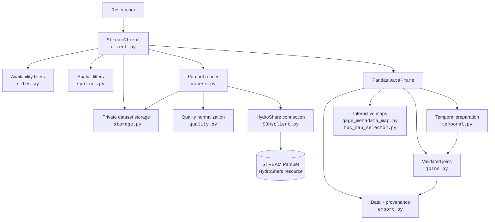
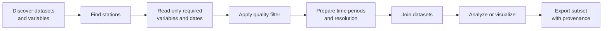
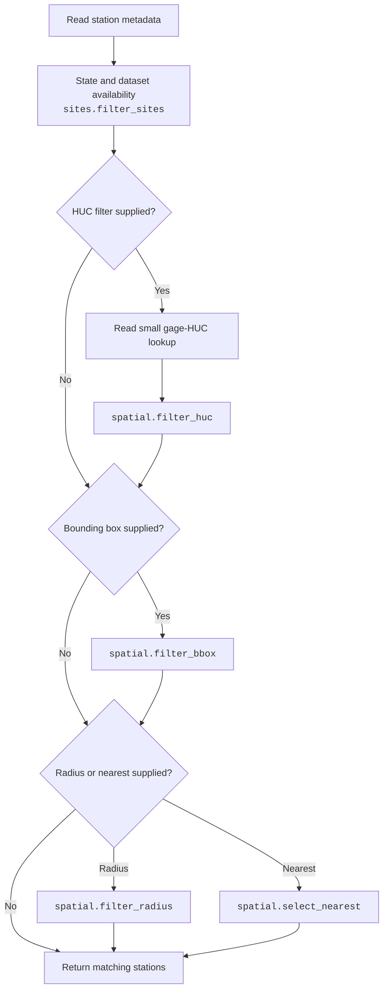
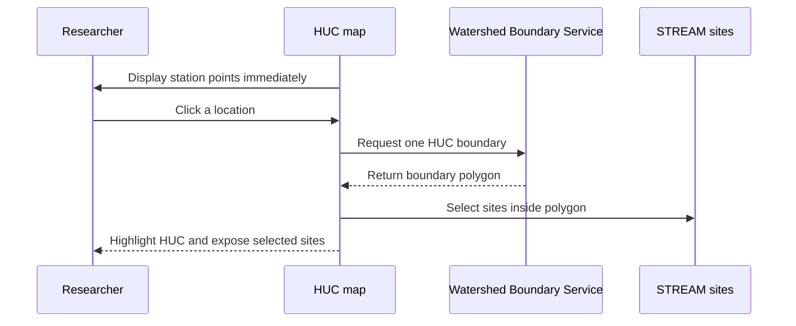

# streamwq Python interface

The public Arrow-first site, metadata, and tabular data APIs require no client
construction:

```python
import streamwq as stream

metadata = stream.get_metadata()
site_ids = metadata.select(["STREAM_ID"]).slice(0, 2)
selected = stream.get_metadata(site_ids)
variables = stream.catalog.VARIABLES["water_quality"]

site_ids = stream.get_sites(states="Virginia", variables=["WTemp_C", "DO_mgL"])
selected_site_metadata = stream.get_metadata(site_ids=site_ids)
observations = stream.get_data(
    "water_quality",
    site_ids=site_ids,
    columns=["STREAM_ID", "DateTime", "WTemp_C", "Flag_WTemp_C"],
    quality="approved",
)
grab_samples = stream.get_data(
    "grab_samples",
    site_ids=site_ids,
    columns=["STREAM_ID", "DateTime", "SSC_mgL"],
)
```

`get_metadata(site_ids=None, *, columns=None)` materializes an Arrow table
without pandas or GeoPandas. It accepts an ID, a sequence of IDs, or a
one-column `STREAM_ID` Arrow table; explicit empty selections raise `ValueError`.
`catalog.DATASETS` is a tuple of names and `catalog.VARIABLES` is a read-only
mapping to tuples of measurement variables. Empty variable tuples indicate
schema-dependent fields, not columnless datasets. Storage paths and connection
details are private. See the [project README](../README.md) for installation,
selection details, and runnable access examples.

`get_sites(...)` returns a materialized Arrow table containing only unique
`STREAM_ID` values. It supports metadata availability filters (`states`,
`variables`, `streamflow`, and `grab_variables`), HUC filters (`huc6` and
`huc8`), a WGS 84 bounding box (`bbox=(west, south, east, north)`), and a
WGS 84 center (`center=(longitude, latitude)`) with `radius_km` or `nearest`.
Different filters combine together; multiple values supplied to one filter
are alternatives. Discovery is based on metadata and does not guarantee
matching observations in a later dataset/date/quality request.

`get_data(dataset, site_ids=None, *, columns=None, start=None, end=None,
quality=None)` supports `water_quality`, `streamflow`,
`static_catchment_characteristics`, `grab_samples`, `meteorology`, `land_cover`,
and `anthropogenic`. It validates all site IDs against metadata before reading
data, accepts the one-column table from `get_sites` directly, and returns a
materialized Arrow table. Omitted `columns` selects the physical dataset
schema; an explicit projection is returned exactly as requested. Inclusive,
timezone-naive date bounds are supported for time-series datasets; quality
filtering is supported only for water quality and streamflow. Static
catchment attributes do not support date filters. Metadata and watershed
geometry remain on their dedicated readers. The Parquet schema, visible on
every returned table (including empty results), defines selectable columns;
`catalog.VARIABLES` remains a measurement-variable list rather than a full
schema. See the [project README](../README.md) for per-dataset filters and
column details.

## Legacy interface

The modules below remain available under the renamed package while later
migration tickets replace their pandas-based APIs. They require the full Pixi
environment and are not imported by the module-level site, metadata, or data
API.
`StreamClient` is not required or newly endorsed for ordinary access.

```python
from streamwq.client import StreamClient

stream = StreamClient()
sites = stream.find_sites(
    states="Virginia",
    variables=["WTemp_C", "DO_mgL"],
    streamflow=True,
)
```

## How the modules connect

The legacy client is the entry point for the remaining readers. It delegates
storage details to `StreamAccess`, while small focused modules perform filtering
and analysis after data has been returned.



The arrows represent direct use or the normal flow of returned data. The
analysis helpers are intentionally independent of `StreamClient`: they accept
ordinary pandas DataFrames and can also be used with data from other sources.

## Typical research workflow



## `StreamClient` reference

Import the client with:

```python
from streamwq.client import StreamClient

stream = StreamClient()
```

| Method | Purpose | Main dependency |
|---|---|---|
| `list_datasets()` | List the dataset names recognized by the legacy client. | Private storage registry |
| `path(name)` | Legacy storage-path accessor; not part of the new catalog contract. | Private storage registry |
| `read_metadata(columns=None)` | Read station metadata, optionally selecting columns. | `StreamAccess.read_metadata()` |
| `find_sites(...)` | Filter stations by state, variable availability, streamflow, grab samples, bounding box, radius, nearest distance, HUC6, or HUC8. | `sites.py`, `spatial.py`, and the metadata/HUC readers |
| `read_water_quality(...)` | Read selected continuous water-quality variables, stations, dates, and quality classes. | `StreamAccess.read_water_quality()` and `quality.py` |
| `read_streamflow(...)` | Read streamflow for selected stations, dates, and quality classes. | `StreamAccess.read_streamflow()` and `quality.py` |
| `read_static_attributes(...)` | Read selected static catchment characteristics. | `StreamAccess.read_static_attributes()` |
| `read_watersheds(...)` | Read watershed geometries for selected stations. | `StreamAccess.read_watersheds()` |
| `read_grab_samples(...)` | Read laboratory grab-sample variables and dates. | `StreamAccess.read_grab_samples()` |
| `read_meteorology(...)` | Read historical meteorological variables and dates. | `StreamAccess.read_meteorology()` |
| `read_land_cover(...)` | Read annual land-cover values; all classes are returned when `variables=None`. | `StreamAccess.read_land_cover()` |
| `read_anthropogenic(...)` | Read annual anthropogenic variables; all variables are returned when `variables=None`. | `StreamAccess.read_anthropogenic()` |

### How `find_sites()` combines filters



All supplied filters are combined. For example, a query can require a station
to be in Virginia, contain two water-quality variables, have streamflow, and be
within 100 km of a point.

## Analysis and selection helpers

### Site and spatial selection

| Function | Description |
|---|---|
| `filter_sites()` | Filter an existing metadata table by state and availability of water quality, streamflow, or grab samples. Normally called through `find_sites()`. |
| `filter_huc()` | Join the gage-HUC lookup and retain selected HUC6 or HUC8 codes. Normally called through `find_sites()`. |
| `filter_bbox()` | Retain stations inside a WGS 84 bounding box. |
| `filter_radius()` | Retain stations within a distance of a longitude/latitude point and add `distance_km`. |
| `select_nearest()` | Return a requested number of nearest stations. |

### Time preparation

Import these legacy functions from `streamwq.temporal`.

| Function | Description |
|---|---|
| `add_water_year()` | Add a water-year label, using October as the default starting month. |
| `filter_season()` | Retain winter, spring, summer, or fall observations. |
| `summarize_observation_period()` | Report record count, first observation, last observation, and duration for each station. |
| `common_observation_period()` | Find the time interval shared by two or more datasets. |
| `resample_timeseries()` | Aggregate numeric observations to daily or monthly mean, median, minimum, maximum, or sum. |

### Joining and export

| Function | Description |
|---|---|
| `join_timeseries()` | Join two datasets on exact `STREAM_ID` and timestamp keys after checking overlap, missing keys, and duplicates. |
| `export_subset()` | Write CSV or Parquet plus a JSON manifest containing the HydroShare resource, query, package version, columns, and export time. |

Example composition:

```python
from streamwq.joins import join_timeseries
from streamwq.temporal import resample_timeseries

daily_quality = resample_timeseries(
    water_quality,
    value_columns=["WTemp_C", "DO_mgL"],
    frequency="daily",
)
daily_flow = resample_timeseries(
    streamflow,
    value_columns="Q_m3s",
    frequency="daily",
)
analysis_data = join_timeseries(daily_quality, daily_flow)
```

## Interactive mapping

| Function | Description |
|---|---|
| `plot_gage_metadata_map()` | Display station points and show station metadata when a point is clicked. |
| `build_huc_selection_map()` | Display station points immediately, then fetch and highlight only the HUC6 or HUC8 boundary clicked by the user. |
| `fetch_huc_boundary()` | Fetch the single HUC boundary containing a longitude/latitude point. |
| `select_sites_in_boundary()` | Return stations covered by a supplied boundary geometry. |

The HUC selector uses lazy boundary loading:



Previously selected boundaries are cached for the current notebook session.

## Internal modules

These components support the public interface and usually do not need to be
called directly by researchers.

| Module | Responsibility |
|---|---|
| `_storage.py` | Private resource identifier, Parquet paths, time columns, and quality-flag mappings. |
| `access.py` | Filtered reads from remote Parquet datasets and conversion to pandas or GeoPandas. |
| `quality.py` | Convert user-friendly quality choices into source flag values. |
| `S3hsclient.py` | Authenticate with HydroShare and provide its S3-compatible filesystem. |

The separation keeps responsibilities clear: `StreamClient` describes what a
researcher wants, `StreamAccess` handles how Parquet data is retrieved, and the
helper modules prepare the returned tables for scientific analysis.

## Tutorials

Runnable examples are located in `notebooks/tutorials/`. Start with the basic
data-access tutorial, then use the advanced tutorials to see multiple client
and analysis functions combined around scientific research questions.
